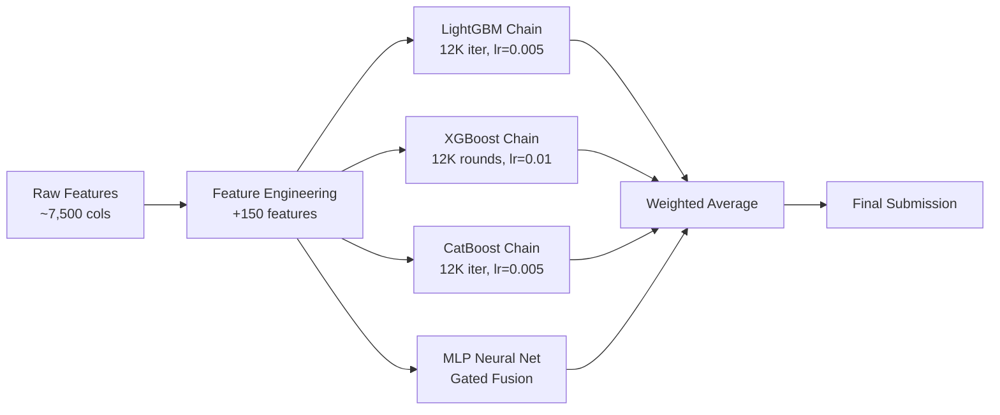
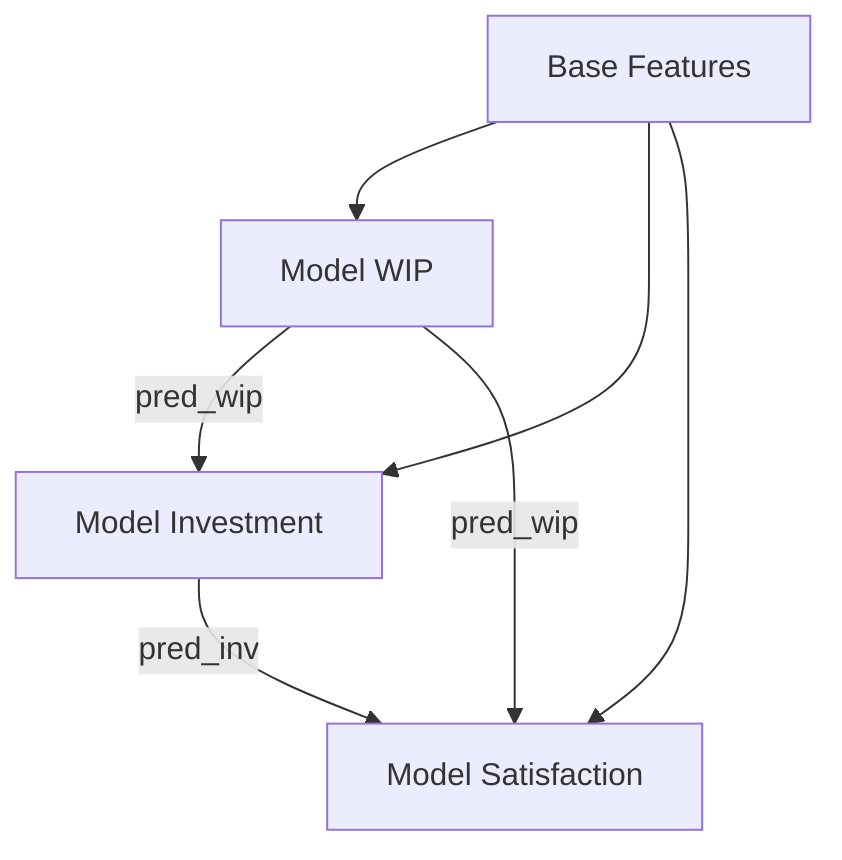
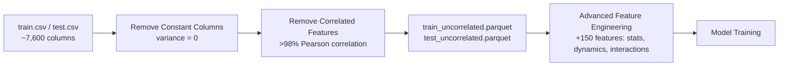

# Airbus Hackathon: 1st Place Solution

> **Industrial Surrogate Modeling Challenge: replacing slow manufacturing simulations with fast ML models to predict helicopter production KPIs**

[](#results)
[](https://www.python.org/)
[](https://lightgbm.readthedocs.io/)
[](https://xgboost.readthedocs.io/)
[](https://pytorch.org/)
[](airbus_hackathon_presentation.pdf)

---

## Context

Airbus Helicopters relies on detailed discrete-event simulations to plan production workshops, modeling demand, resource allocation, and delivery scheduling. While accurate, these simulations take hours per scenario.

The goal of this hackathon (jointly organized for **IMT Mines Alès** and **ISAE-SUPAERO** around Maryam Saadi's PhD research with Airbus Helicopters) was to build **ML surrogate models** capable of predicting workshop performance indicators in milliseconds for rapid what-if analysis.

* **Project Presentation**: For a visual walkthrough of our methodology, plots, and architecture, see [airbus_hackathon_presentation.pdf](airbus_hackathon_presentation.pdf).

### The Challenge

Given ~7,500 input features describing:
* **Demand features** (~7,540 binary columns): helicopter part demand scenarios across time periods
* **Workshop parameters** (~51 continuous columns): assembly workshop settings over 3 years (`year0`, `year1`, `year2`)

Predict **3 interdependent KPIs simultaneously**:

| KPI | Description | Typical Scale |
|---|---|---|
| **WIP** (Work In Progress) | Production volume in progress | ~20M to 30M |
| **Investment** (`Investissement`) | Resources required for workshop setup | ~750K to 1.25M |
| **Satisfaction** (Customer Satisfaction) | Share of parts delivered on time | 0.33 to 0.99 |

### Evaluation Metric

**Primary metric**: Percentage of Satisfaction predictions within **±0.05** of the true value:

$$\text{Accuracy} = \frac{1}{N} \sum_{i=1}^{N} \mathbb{1}\left[|\hat{y}_i^{\text{sat}} - y_i^{\text{sat}}| \leq 0.05\right]$$

---

## Results

Our team finished **1st out of 15 participating teams** on the final private leaderboard. Combining a chained gradient boosting pipeline with a custom dual-pathway neural network proved more accurate and robust than any single model family alone.

| Approach | Role in Final Solution | Key Performance |
|---|---|---|
| **Chained LightGBM** | Best single model | ~0.83 tolerance accuracy (5-fold CV) |
| **Dual-Pathway MLP** | Complementary neural model | ~0.81 tolerance accuracy (6.5M params) |
| **Chained XGBoost & CatBoost** | Ensemble diversity | Reduces variance across folds |
| **Weighted Ensemble** | **Winning submission** | **1st Place (15 teams, private leaderboard)** |

---

## Our Winning Approach

We combined **model diversity** with **weighted ensembling** across independently trained gradient boosting chains and a custom neural network.

### Key Insights

1. **Regressor Chain**: The three KPIs are causally linked (WIP feeds Investment, and both inform Satisfaction). Training sequentially lets the final Satisfaction model see the full workshop context.
2. **Feature Engineering**: ~150 engineered features capturing demand summaries, temporal dynamics (year-over-year deltas and acceleration), and cross-feature ratios.
3. **Model Diversity**: LightGBM, XGBoost, CatBoost, and a Gated Fusion MLP make partially uncorrelated errors, making weighted averaging consistently effective.
4. **Satisfaction Prioritization**: Loss functions weight Satisfaction 2 to 3 times higher than WIP and Investment to align training with the leaderboard metric.

### Architecture Overview



### Regressor Chain Strategy



---

## Models in Detail

### 1. Chained LightGBM *(Best single model)*

| Parameter | Value |
|---|---|
| `iterations` | 12,000 |
| `learning_rate` | 0.005 |
| `num_leaves` | 63 |
| `subsample` | 0.7 |
| `colsample_bytree` | 0.6 |
| `metric` | MAE |

* **5-Fold CV** with early stopping (100 rounds) and fold-averaged test predictions
* Advanced feature engineering applied
* Implementation: [`src/models/gradient_boosting/chain_lgbm.py`](src/models/gradient_boosting/chain_lgbm.py)

### 2. Chained XGBoost

| Parameter | Value |
|---|---|
| `rounds` | 12,000 |
| `learning_rate` | 0.01 |
| `max_depth` | 8 |
| `objective` | `reg:absoluteerror` (MAE) |

* Same regressor chain and 5-fold CV strategy as LightGBM
* Implementation: [`src/models/gradient_boosting/chain_xgboost.py`](src/models/gradient_boosting/chain_xgboost.py)

### 3. Chained CatBoost

| Parameter | Value |
|---|---|
| `iterations` | 12,000 |
| `learning_rate` | 0.005 |
| `depth` | 8 |
| `loss_function` | MAE |
| `early_stopping` | 200 rounds |

* Implementation: [`src/models/gradient_boosting/chain_catboost.py`](src/models/gradient_boosting/chain_catboost.py)

### 4. MLP Neural Network

* **Dual-pathway architecture**: separate branches for sparse demand features and dense workshop parameters
* **Gated fusion mechanism** to combine both pathways without dense parameters being drowned out
* Custom `SatisfactionThresholdLoss`: weighted MAE plus an extra penalty outside the ±0.05 tolerance zone
* Hyperparameter search over **960+ configurations** via YAML grid
* Implementation: [`src/models/neural_network/mlp.py`](src/models/neural_network/mlp.py)

### 5. Stacking Ensemble

* **Level 1**: Two CatBoost experts trained on separate feature subsets (demand-only vs. parameter-only)
* **Level 2**: LightGBM meta-learner combining expert predictions via a Regressor Chain
* Implementation: [`src/models/stacking/stacking_ensemble.py`](src/models/stacking/stacking_ensemble.py)

---

## Data Pipeline



### Feature Engineering Summary

| Category | # Features | Description |
|---|:---:|---|
| **Demand Stats** | 13 | sum, mean, std, max, min, Q25, median, Q75, range, skew, kurtosis, CV, zero count |
| **Param Global** | 4 | mean, std, max, min across all parameter columns |
| **Param Per-Year** | 12 | mean, std, sum, max for `year0`, `year1`, and `year2` |
| **Temporal Dynamics** | ~51 | year-over-year deltas and acceleration for each workshop parameter |
| **Interactions** | 2 | `demand_mean / param_mean` ratio and `demand_max * param_max` product |

---

## Repository Structure

```text
airbus-hackathon/
├── README.md
├── airbus_hackathon_presentation.pdf             # Project presentation slides (PDF)
├── requirements.txt
├── .gitignore
│
├── src/
│   ├── preprocessing/
│   │   ├── clean_dataset.py                      # Data cleaning pipeline
│   │   └── feature_engineering.py                # Feature engineering (~150 features)
│   ├── models/
│   │   ├── gradient_boosting/
│   │   │   ├── chain_lgbm.py                     # Chained LightGBM (best single model)
│   │   │   ├── chain_xgboost.py                  # Chained XGBoost
│   │   │   └── chain_catboost.py                 # Chained CatBoost
│   │   ├── neural_network/
│   │   │   └── mlp.py                            # Dual-pathway gated MLP with custom loss
│   │   └── stacking/
│   │       └── stacking_ensemble.py              # Two-level stacking (CatBoost + LightGBM)
│   └── ensemble/
│       └── average_predictions.py                # Weighted ensemble averaging
│
├── notebooks/
│   ├── CleanDataset.ipynb                        # Data cleaning walkthrough
│   ├── EDA.ipynb                                 # Exploratory data analysis
│   └── feature_engineering.ipynb                 # Feature engineering exploration
│
├── data/
│   ├── sample_submission.csv                     # Expected output format
│   ├── train_cleaned.parquet                     # After constant column removal
│   ├── test_cleaned.parquet
│   ├── train_uncorrelated.parquet                # After correlation filtering (training ready)
│   ├── test_uncorrelated.parquet
│   └── feature_importance_ranking.csv
│
└── submissions/
    ├── submission_ensemble_avg.csv               # Winning submission
    ├── submission_chained_lgbm.csv
    ├── submission_chained_lgbm_10000estimators.csv
    ├── submission_chained_lgbm_3params.csv
    ├── submission_ensemble_4006.csv
    └── submission_mlp_final.csv
```

---

## Reproducing Results

### 1. Setup

```bash
git clone https://github.com/romainsebire/airbus-hackathon.git
cd airbus-hackathon
pip install -r requirements.txt
```

### 2. Data Preparation

Place the raw competition data (`train.csv`, `test.csv`) inside `data/` and run the cleaning pipeline:

```bash
python src/preprocessing/clean_dataset.py
```

This generates `train_uncorrelated.parquet` and `test_uncorrelated.parquet`.

> **Note**: Pre-cleaned Parquet files are already included in `data/`, so raw CSVs are only needed if you want to reproduce cleaning from scratch.

### 3. Train Individual Models

```bash
# LightGBM (best single model)
python src/models/gradient_boosting/chain_lgbm.py

# XGBoost
python src/models/gradient_boosting/chain_xgboost.py

# CatBoost
python src/models/gradient_boosting/chain_catboost.py
```

Each script runs 5-fold cross-validation, logs per-fold Satisfaction accuracy, and saves predictions to `submissions/`.

### 4. Create Ensemble (Winning Submission)

```bash
python src/ensemble/average_predictions.py
```

---

## Tech Stack

| Tool | Purpose |
|---|---|
| **LightGBM** | Gradient boosting (best single model performance) |
| **XGBoost** | Gradient boosting (diverse ensemble member) |
| **CatBoost** | Gradient boosting (robust to hyperparameters) |
| **PyTorch** | Dual-pathway Gated Fusion MLP |
| **scikit-learn** | Cross-validation, preprocessing, and metrics |
| **Pandas / NumPy** | Data manipulation |
| **Parquet (PyArrow)** | Compact columnar storage (10x smaller than CSV) |

---

## Authors

**Romain Sebire**, **Arthur Wavreille**, **Rémy Plastre**, **Xin Yin Lee** & **Léonard Vincenzi** (IMT Mines Alès, December 2025)

---

## License

Academic project developed for the Airbus Helicopters Hackathon organized for IMT Mines Alès and ISAE-SUPAERO students (December 2025).
