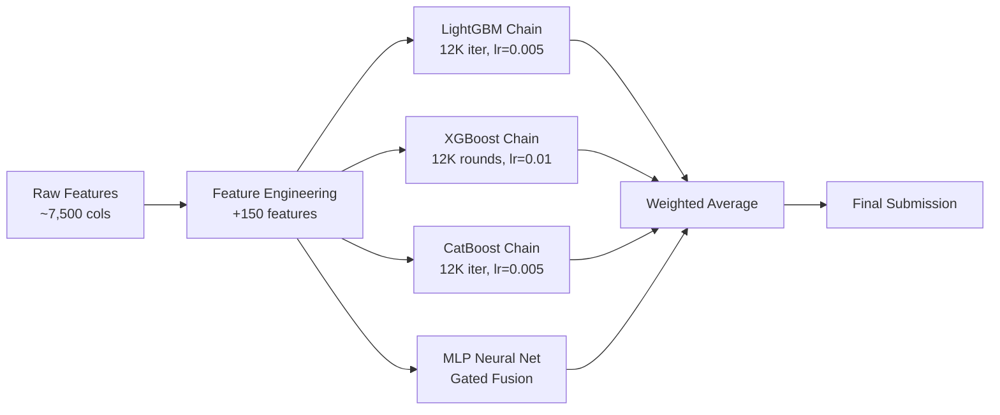
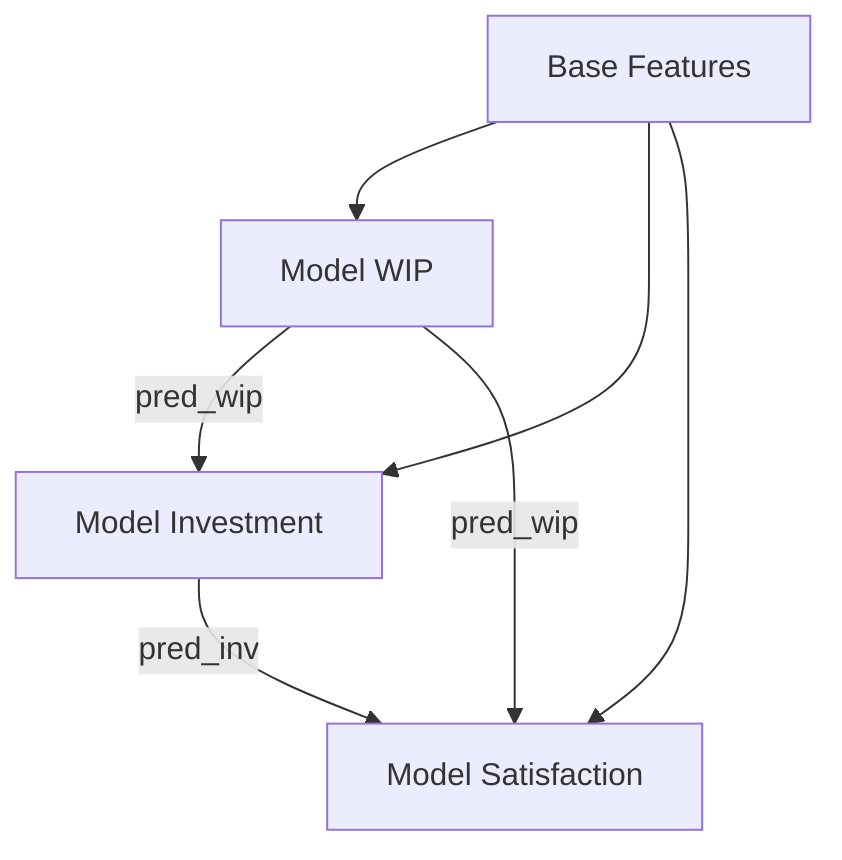
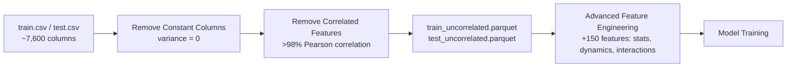

# Airbus Hackathon — 1st Place Solution

> **Industrial Surrogate Modeling Challenge** — Replacing slow manufacturing simulations with fast ML models to predict helicopter production KPIs.

[](https://python.org)
[](https://lightgbm.readthedocs.io)
[](https://xgboost.readthedocs.io)
[](https://pytorch.org)

---

## Context

Airbus Helicopters uses complex industrial simulations to plan production workshops. These simulations model the entire supply chain — demand forecasting, resource allocation, and delivery scheduling — but are **extremely slow to run** (hours per scenario).

The goal of this hackathon was to build **ML surrogate models** that approximate the simulation output in milliseconds, enabling rapid what-if analysis for production planning.

### The Challenge

Given ~7,500 input features describing:
- **Demand features** (~7,540 binary columns): helicopter part demand scenarios across time periods
- **Param features** (~51 continuous columns): workshop configuration parameters over 3 years (year0, year1, year2)

Predict **3 KPIs simultaneously**:

| KPI | Description | Scale |
|-----|-------------|-------|
| **WIP** (Work In Progress) | Production volume in progress | ~20M–30M |
| **Investissement** (Investment) | Resources for workshop setup | ~750K–1.25M |
| **Satisfaction** (Customer Satisfaction) | % of parts delivered on time | 0.33–0.99 |

### Evaluation Metric

**Primary metric**: Percentage of Satisfaction predictions within **±0.05** of the true value.

$$\text{Accuracy} = \frac{1}{N} \sum_{i=1}^{N} \mathbb{1}\left[|\hat{y}_i^{\text{sat}} - y_i^{\text{sat}}| \leq 0.05\right]$$

---

## Our Winning Approach

We won by combining **model diversity** with **intelligent ensembling**. Our final submission was a **weighted average** of predictions from 4 independently trained models, each bringing different strengths.

### Key Insights

1. **Regressor Chain** — The 3 KPIs are correlated (WIP → Investment → Satisfaction). We train sequentially: predict WIP first, then use it as an additional feature for Investment, then both for Satisfaction.

2. **Advanced Feature Engineering** — ~150 engineered features capturing demand statistics, temporal dynamics (year-over-year deltas, acceleration), and cross-feature interactions.

3. **Model Diversity** — LightGBM, XGBoost, CatBoost, and MLP each capture different patterns. Their errors are partially uncorrelated, making averaging effective.

4. **Satisfaction Prioritization** — All models weight satisfaction 2–3× higher than other KPIs in their loss functions.

### Architecture Overview



### Regressor Chain Strategy



---

## Models in Detail

### 1. Chained LightGBM *(Best single model)*

| Parameter | Value |
|-----------|-------|
| iterations | 12,000 |
| learning_rate | 0.005 |
| num_leaves | 63 |
| subsample | 0.7 |
| colsample_bytree | 0.6 |
| metric | MAE |

- **5-Fold CV** with early stopping (100 rounds)
- Test predictions averaged across folds
- Advanced feature engineering applied
- See: [`src/models/gradient_boosting/chain_lgbm.py`](src/models/gradient_boosting/chain_lgbm.py)

### 2. Chained XGBoost

| Parameter | Value |
|-----------|-------|
| rounds | 12,000 |
| learning_rate | 0.01 |
| max_depth | 8 |
| objective | `reg:absoluteerror` (MAE) |

- Same chain + CV strategy as LightGBM
- See: [`src/models/gradient_boosting/chain_xgboost.py`](src/models/gradient_boosting/chain_xgboost.py)

### 3. Chained CatBoost

| Parameter | Value |
|-----------|-------|
| iterations | 12,000 |
| learning_rate | 0.005 |
| depth | 8 |
| loss_function | MAE |
| early_stopping | 200 rounds |

- See: [`src/models/gradient_boosting/chain_catboost.py`](src/models/gradient_boosting/chain_catboost.py)

### 4. MLP Neural Network

- **Dual-pathway architecture**: separate branches for demand (binary) and param (continuous) features
- **Gated fusion mechanism** to combine both pathways
- Custom `SatisfactionThresholdLoss`: MAE + penalty for predictions outside ±0.05 zone
- Hyperparameter search over **960+ configurations** via YAML grid
- See: [`src/models/neural_network/mlp.py`](src/models/neural_network/mlp.py)

### 5. Stacking Ensemble

- **Level 1**: Two CatBoost experts trained on separate feature subsets (demand-only vs. param-only)
- **Level 2**: LightGBM meta-learner combining expert predictions via RegressorChain
- See: [`src/models/stacking/stacking_ensemble.py`](src/models/stacking/stacking_ensemble.py)

---

## Data Pipeline



### Feature Engineering Details

| Category | # Features | Description |
|----------|:----------:|-------------|
| **Demand Stats** | 13 | sum, mean, std, max, min, Q25, median, Q75, range, skew, kurtosis, CV, zero_count |
| **Param Global** | 4 | mean, std, max, min across all param columns |
| **Param Per-Year** | 12 | mean, std, sum, max for year0 / year1 / year2 |
| **Temporal Dynamics** | ~51 | year-over-year deltas (Δy1-y0, Δy2-y1) and acceleration for each param f0–f16 |
| **Interactions** | 2 | demand_mean / param_mean ratio, demand_max × param_max product |

---

## Repository Structure

```
hackathon-airbus/
├── README.md
├── requirements.txt
├── .gitignore
│
├── src/                                  # Clean, modular source code
│   ├── preprocessing/
│   │   ├── clean_dataset.py              # Data cleaning pipeline
│   │   └── feature_engineering.py        # Advanced feature engineering (~150 features)
│   ├── models/
│   │   ├── gradient_boosting/
│   │   │   ├── chain_lgbm.py             # Chained LightGBM (best single model)
│   │   │   ├── chain_xgboost.py          # Chained XGBoost
│   │   │   └── chain_catboost.py         # Chained CatBoost
│   │   ├── neural_network/
│   │   │   └── mlp.py                    # MLP with custom losses & dual-pathway
│   │   └── stacking/
│   │       └── stacking_ensemble.py      # Two-level stacking (CatBoost + LightGBM)
│   └── ensemble/
│       └── average_predictions.py        # Weighted ensemble averaging
│
├── notebooks/                            # Exploration & analysis
│   ├── CleanDataset.ipynb                # Data cleaning walkthrough
│   ├── EDA.ipynb                         # Exploratory data analysis
│   └── feature_engineering.ipynb         # Feature engineering exploration
│
├── data/                                 # Data directory
│   ├── sample_submission.csv             # Expected output format
│   ├── train_cleaned.parquet             # After constant column removal
│   ├── test_cleaned.parquet
│   ├── train_uncorrelated.parquet        # After correlation filtering (ready for training)
│   ├── test_uncorrelated.parquet
│   └── feature_importance_ranking.csv
│
├── submissions/                          # Model predictions
│   ├── submission_ensemble_avg.csv       # WINNING SUBMISSION
│   ├── submission_chained_lgbm_10000estimators.csv
│   ├── submission_chained_lgbm_3params.csv
│   ├── submission_chained_xgboost_10000rounds.csv
│   ├── submission_ensemble_4006.csv
│   └── submission_mlp_final.csv
```

---

## Reproducing Results

### 1. Setup

```bash
git clone https://github.com/romainsebire/airbus-hackathon.git
cd airbus-hackathon
pip install -r requirements.txt
```

### 2. Data Preparation

Place the raw competition data (`train.csv`, `test.csv`) in the `data/` directory, then run the cleaning pipeline:

```bash
python src/preprocessing/clean_dataset.py
```

This produces `train_uncorrelated.parquet` and `test_uncorrelated.parquet`.

> **Note**: The cleaned parquet files are already included in this repo (~80 MB total). You only need the raw CSVs if you want to reproduce the cleaning step from scratch.

### 3. Train Individual Models

```bash
# LightGBM (best single model)
python src/models/gradient_boosting/chain_lgbm.py

# XGBoost
python src/models/gradient_boosting/chain_xgboost.py

# CatBoost
python src/models/gradient_boosting/chain_catboost.py
```

Each script trains with 5-fold CV, prints per-fold satisfaction accuracy, and saves a submission CSV to `submissions/`.

### 4. Create Ensemble (Winning Submission)

```bash
python src/ensemble/average_predictions.py
```

This averages the individual model predictions into the final winning submission.

---

## Tech Stack

| Tool | Purpose |
|------|---------|
| **LightGBM** | Gradient boosting — best single model performance |
| **XGBoost** | Gradient boosting — diverse ensemble member |
| **CatBoost** | Gradient boosting — robust to hyperparameters |
| **PyTorch** | MLP neural network |
| **scikit-learn** | Cross-validation, preprocessing, metrics |
| **Pandas / NumPy** | Data manipulation |
| **Parquet (PyArrow)** | Efficient data storage (10× smaller than CSV) |

---

*Developed as part of an academic hackathon organized by Airbus for ISAE-SUPAERO / IAIL students — December 2025.*
